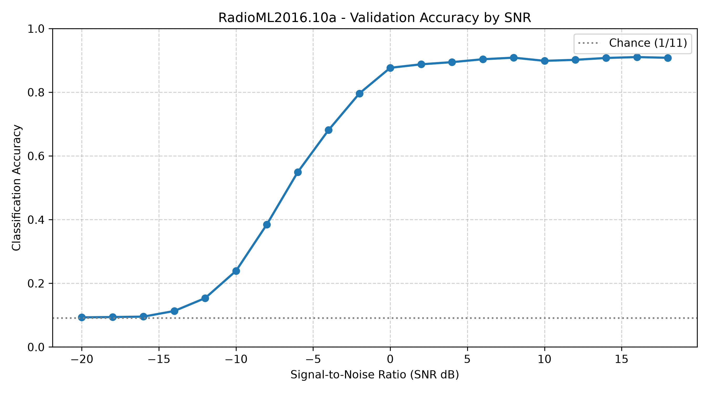
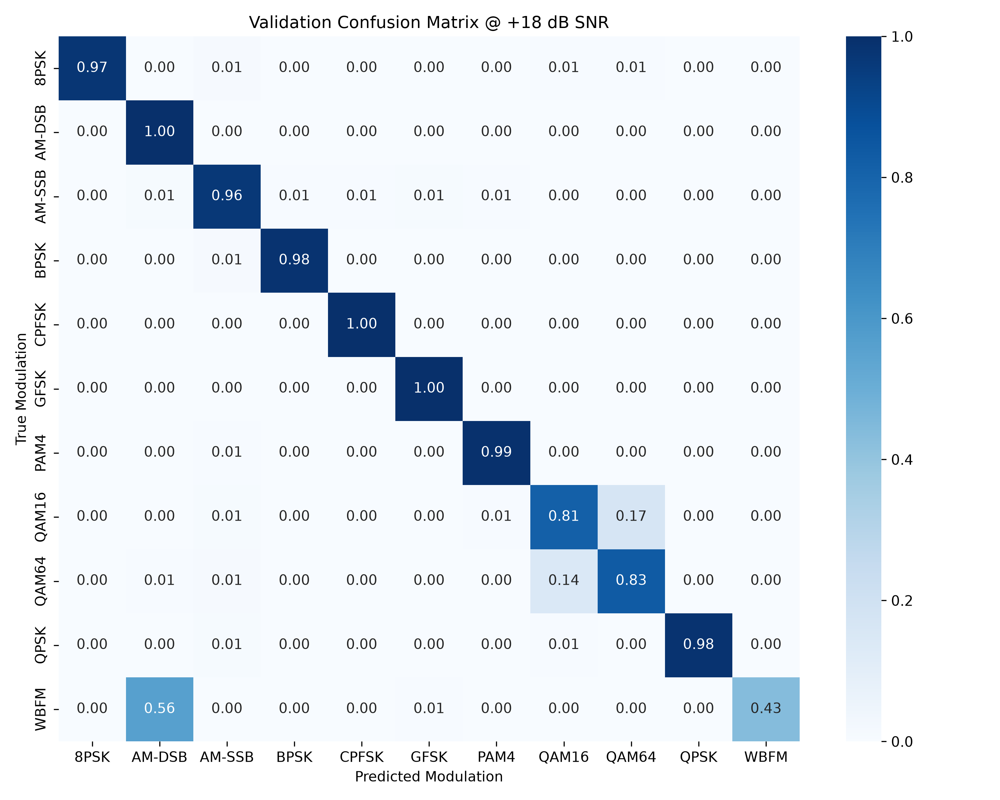

# SpectraSense

**RF Sinyal İstihbaratı için Otomatik Modülasyon Sınıflandırma — RadioML2016.10a Mühendislik Raporu**

SpectraSense, Elektronik Harp (EW) ve Sinyal İstihbaratı (SIGINT) uygulamalarına yönelik Otomatik Modülasyon Sınıflandırma (AMC) araştırması için geliştirilmiş bir derin öğrenme boru hattıdır. Karmaşık temel bant I/Q pencerelerinden 11 analog/dijital modülasyonu tanır; başarımı sinyal-gürültü oranına göre raporlar.

**Faz 1 sonucu:** 44.000 doğrulama örneğinde genel doğruluk **%60,99**, SNR ≥ 0 dB koşulunda **%89,98 (~%90,0)**. Sonuçlar, GNU Radio ile üretilmiş özgün RadioML2016.10a veri kümesine aittir; saha kaydı veya operasyonel EW yeterlilik testi değildir.

## 1. Mimari yaklaşım

### Fiziksel RF öznitelikleri

Karmaşık temel bant sinyali `x[n] = I[n] + jQ[n]` olarak temsil edilir. I (In-phase) gerçek, Q (Quadrature) sanal bileşendir. Her pencere ortak RMS ile ölçeklenir:

```text
r = sqrt(mean(I² + Q²))
I_norm = I / max(r, 1e-8)
Q_norm = Q / max(r, 1e-8)
Amplitude = sqrt(I_norm² + Q_norm²)
Phase = atan2(Q_norm, I_norm)
```

I ve Q için aynı ölçek kullanılması göreli genlik ve faz ilişkisini korur. Normalize edilmiş I/Q'ya anlık genlik ve radyan cinsinden anlık faz eklenerek **(I, Q, Amp, Phase)** biçiminde **(4, 128)** giriş oluşturulur. `atan2`, fazın dört bölgesini de doğru temsil eder.

Genlik kanalı zarf değişimlerini; faz kanalı açısal yapıyı doğrudan erişilebilir kılar. Zaman içindeki faz değişimleri frekans davranışıyla ilişkilidir. Bu temsil, QAM/PAM genlik seviyeleri ile PSK/FSK faz örüntülerinin öğrenilmesini kolaylaştırmayı amaçlar. Amp ve Phase, I/Q'nun deterministik dönüşümleridir; yeni ölçüm bilgisi eklemez. Başarım artışını yalnızca bu kanallara atfetmek için aynı koşullarda iki kanallı bir **ablasyon deneyi** gerekir; bu karşılaştırma henüz yapılmadı. Faz kanalında ±π sarılması vardır; giriş açık bir faz açma veya PLL işlemi içermez.

### Residual 1D-CNN

```text
I/Q (2 × 128)
  → Ortak RMS normalizasyonu
  → Genlik / faz çıkarımı (4 × 128)
  → Conv1D(4 → 24, kernel=7) + BatchNorm + ReLU
  → Residual blok (24 → 24)
  → Residual blok (24 → 48, stride=2)
  → Residual blok (48 → 64, stride=2)
  → AdaptiveAvgPool1D(4)
  → Flatten + Dropout + Linear(256 → 128) + ReLU
  → Dropout + Linear(128 → 11)
```

Residual bloklar 5 ve 3 uzunluklu çekirdekler kullanır; boyut değiştiğinde kısayol bağlantısında 1×1 konvolüsyon bulunur. Yerel zaman örüntüleri konvolüsyonlarla işlenirken residual bağlantılar gradyan akışını destekler. Model `(2, 128)` girişini de destekler; `model.in_channels: 2` seçimi yeniden eğitim gerektirir.

## 2. Veri ve deney protokolü

| Özellik | Değer |
| --- | --- |
| Veri kümesi | DeepSig / RadioML2016.10a |
| Toplam pencere | 220.000 |
| Ham pencere boyutu | 2 × 128 (I/Q) |
| Modülasyon sayısı | 11 |
| SNR aralığı | −20 ile +18 dB, 2 dB adım; 20 seviye |
| Her modülasyon–SNR grubu | 1.000 örnek |
| Ayrım | Her grupta 800 eğitim / 200 doğrulama |
| Toplam eğitim / doğrulama | 176.000 / 44.000 |
| Her doğrulama SNR seviyesinde | 2.200 örnek |
| Yüksek SNR doğrulama alt kümesi | SNR ≥ 0 dB; 22.000 örnek |
| Rastgelelik tohumu | 42 |

**Sınıflar:** BPSK, QPSK, 8PSK, QAM16, QAM64, CPFSK, GFSK, PAM4, WBFM, AM-DSB, AM-SSB.

Veri, kullanıcının sağladığı `archive (1).zip` içindeki `RML2016.10a_dict.pkl` dosyasından yüklenir. Bu projedeki basitleştirilmiş sentetik veri üretimi kaldırılmıştır. Bununla birlikte RadioML'nin kendisi GNU Radio tabanlı bir simülasyon veri kümesidir. Özgün üretici dinamik kanal üzerinden gürültü, frekans/zamanlama sapmaları ve çok yollu yayılım etkilerini modeller. [RadioML üretim kodu](https://github.com/radioML/dataset/blob/master/generate_RML2016.10a.py), [DeepSig veri kümesi açıklaması](https://www.deepsig.ai/datasets/).

Yükleyici eksik dosyayı ve **50 MB altındaki** dosyayı reddeder; 220 grubun her birinde `(1000, 2, 128)` şekli ve sonlu sayılar aranır. Gerçek dosyanın boyutu 640.919.653 bayttır. Boyut ve şema kontrolü veri bütünlüğü için yardımcı kontrollerdir; tek başına kaynak özgünlüğünü ispatlamaz.

**Değerlendirme sınırı:** %20'lik küme her epoch izlenmiş ve checkpoint seçiminde kullanılmıştır. Bu nedenle rapordaki metrikler **doğrulama başarımıdır; bağımsız, hiç görülmemiş test başarımı değildir**. Pencere düzeyindeki ayrım, kaynak kayıt/üretim oturumu düzeyinde bağımsızlık garantisi de vermez. Saha genellemesi için oturum/verici bazında ayrılmış ek değerlendirme gerekir.

### Eğitim yapılandırması

| Parametre | Değer |
| --- | --- |
| Optimizasyon | AdamW |
| Başlangıç öğrenme oranı | 0,001 |
| Weight decay | 0,0001 |
| Öğrenme oranı çizelgesi | CosineAnnealingLR; T_max=30 |
| Kayıp | CrossEntropyLoss |
| Batch size | 256 |
| Dropout | 0,3 |
| Epoch | 30 |
| Donanım | CPU, 6 PyTorch iş parçacığı |
| Toplam epoch süresi | Yaklaşık 22,1 dakika |
| Model seçimi | En yüksek genel doğrulama doğruluğu; **epoch 29** |

Her epoch sonunda `Overall Val Acc` ve `High-SNR Val Acc (SNR >= 0 dB)` ayrı yazdırılır. Yapılandırma [configs/radioml.yaml](configs/radioml.yaml), epoch kayıtları [training_history.json](results/training_history.json) içindedir.

## 3. Deneysel sonuçlar

20 Ekim 2026 tarihli çalıştırmanın kesin metrik kaynağı [results/metrics.json](results/metrics.json) dosyasıdır.

| Ölçüm | Doğruluk |
| --- | ---: |
| Genel doğruluk — tüm SNR seviyeleri | **%60,99** |
| Yüksek SNR — SNR ≥ 0 dB | **%89,98** |
| +18 dB | **%90,82** |
| 0 dB | %87,68 |
| −2 dB | %79,64 |
| −8 dB | %38,50 |
| −20 dB | %9,32 |



### +18 dB sınıf bazında başarım

Her sınıfın 200 doğrulama örneği vardır. Aşağıdaki değerler sınıf duyarlılığıdır (`recall = doğru sınıflanan / gerçek sınıf örneği`); karışıklık matrisinin köşegenine karşılık gelir. İki basamakla gösterilen grafikteki yuvarlamalar yerine kayıtlı tahminlerden hesaplanan kesin oranlar verilmiştir.

| Modülasyon | Doğru / toplam | Recall |
| --- | ---: | ---: |
| CPFSK | 200 / 200 | %100,0 |
| GFSK | 200 / 200 | %100,0 |
| AM-DSB | 200 / 200 | %100,0 |
| PAM4 | 199 / 200 | %99,5 |
| BPSK | 197 / 200 | %98,5 |
| QPSK | 197 / 200 | %98,5 |
| 8PSK | 195 / 200 | %97,5 |
| AM-SSB | 193 / 200 | %96,5 |
| QAM64 | 167 / 200 | %83,5 |
| QAM16 | 163 / 200 | %81,5 |
| WBFM | 87 / 200 | %43,5 |



Matris +18 dB alt kümesine aittir ve satır bazında normalize edilmiştir. Satırlar gerçek, sütunlar tahmin edilen sınıftır. 200 örnekte %100 başarı, sınıfın her koşulda hatasız tanındığı anlamına gelmez.

## 4. Mühendislik analizi: Sonuçlar neden böyle çıktı?

### 4.1 Gürültü tabanı: −20 ile −14 dB

SNR'nin güç oranı tanımı `SNR_dB = 10 log10(P_signal / P_noise)` olduğundan −20 dB, gürültü gücünün sinyal gücünün **100 katı** olduğu koşulu ifade eder. Çok kısa gözlem pencerelerinde sınıfları ayıran zarf ve faz yapılarının gürültü tarafından baskılanması beklenir.

Dengeli 11 sınıf için rastgele tahmin referansı `1/11 ≈ %9,09`'dur. Ölçülen −20 dB sonucu **%9,318… → %9,32**, −14 dB sonucu ise %11,32'dir. Alt uçtaki bu davranış gürültü baskın koşulla tutarlıdır; bir uygulama hatası olmak zorunda değildir. Ancak **rastgele tahmine yakın doğruluk, veri sızıntısının bulunmadığını kanıtlamaz**; bunun için ayrım ve kaynak bağımsızlığı ayrıca denetlenmelidir.

Shannon–Hartley bağıntısı `C = B log2(1 + S/N)` ile −20 dB için `C/B ≈ 0,0144 bit/s/Hz` verir: kapasite çok düşüktür fakat sıfır değildir. Bu bağıntı bir iletişim kapasitesi sınırıdır; 128 örneklik modülasyon sınıflandırma doğruluğunu doğrudan belirlemez. Dolayısıyla “bilgi tamamen kaybolur” çıkarımı yapılmaz.

### 4.2 Geçiş ve yakalama bölgesi: −10 ile 0 dB

Doğruluk −10 dB'de %23,91'den −8 dB'de **%38,50**'ye, −2 dB'de **%79,64**'e ve 0 dB'de **%87,68**'e yükselir. 0 dB'de sinyal ve gürültü güçleri eşittir. Eğrinin S-biçimli görünümü, SNR yükseldikçe ayırt edici zaman/genlik/faz örüntülerinin daha güvenilir kullanılabildiği yorumuyla uyumludur.

Dört kanallı temsil bu örüntülere doğrudan erişim sağlar; residual CNN zamansal ilişkileri öğrenir. Bununla birlikte modelde fiziksel bir taşıyıcı/faz kilitleme döngüsü yoktur. Eğri, “çok düşük SNR'da faz ve frekans kilitlenmesinin kanıtı” olarak yorumlanmamalıdır. Mimari bileşenlerin katkısı ayrı deneylerle ölçülmelidir.

### 4.3 WBFM / AM-DSB: kısa pencerelerde taşıyıcı benzerliği

+18 dB'de WBFM örneklerinin **%43,5'i doğru**, **%56'sı AM-DSB** olarak sınıflandırılmıştır. AM-DSB'nin aynı alt kümede recall değeri %100'dür; karışıklık simetrik değildir.

RadioML'nin analog kaynak kodu ses dosyası kullanır. İdeal FM'de `f_inst(t) = f_c + k_f m(t)` olduğundan sesin sessiz veya çok düşük genlikli olduğu aralıklarda frekans sapması küçülür; sinyal taşıyıcıya yaklaşır. Taşıyıcılı AM için `s_AM(t) = A_c[1 + μm(t)]cos(2πf_ct + φ)` de `m(t) ≈ 0` iken taşıyıcı baskındır. Özgün AM-DSB üreticisinde sabit taşıyıcı bileşeni bulunur. Bu mekanizma, kısa gözlemlerde iki sınıfın benzeşmesine ilişkin **olası bir fiziksel açıklamadır**. [Ses kaynağı](https://github.com/radioML/dataset/blob/master/source_alphabet.py), [modülatörler](https://github.com/radioML/dataset/blob/master/transmitters.py).

Farklı kanal, faz ve gürültü gerçekleşimleri nedeniyle iki kaydın I/Q izinin birebir aynı olması gerekmez. Bu çalışmada hatalı pencerelerin ses içeriği ayrı incelenmedi; %56 oranının tamamı sessizliğe bağlanamaz.

**Pencere süresi:** `T = 128 / f_s`. “128 örnek = 128 µs” yalnızca `f_s = 1 MHz` için geçerlidir. Üretim kodundaki 200 kHz nominal kanal örnekleme hızı esas alınırsa süre yaklaşık **640 µs** olur; fiziksel süre ilgili akışın gerçek örnekleme hızına bağlıdır. [Üretici yapılandırması](https://github.com/radioML/dataset/blob/master/generate_RML2016.10a.py).

### 4.4 QAM16 / QAM64: benzer geometri, sınırlı gözlem

+18 dB'de QAM16 recall **%81,5**, QAM64 recall **%83,5**'tir. QAM16 örneklerinin **%17'si QAM64**, QAM64 örneklerinin **%14,5'i QAM16** olarak tahmin edilmiştir.

İki modülasyon da karesel takımyıldız yapısındadır. Normalize edilmemiş ideal koordinatlarda 16-QAM seviyeleri `±1, ±3`, 64-QAM seviyeleri `±1, ±3, ±5, ±7` seçilebilir. Ancak birim ortalama enerji normalizasyonları sırasıyla `sqrt(10)` ve `sqrt(42)` olduğundan, **normalize takımyıldızları genel olarak birebir alt küme kabul etmek doğru değildir**.

128 zaman örneği, darbe şekillendirme ve aşırı örnekleme nedeniyle 128 bağımsız sembol demek değildir. Kısa pencerede sembol dağılımının sınırlı gözlenmesi; gürültü, kazanç/faz belirsizliği ve çok yollu yayılımın oluşturduğu semboller arası girişim, benzer kare geometrileri ayırmayı zorlaştırabilir. Genlik/faz öznitelikleri bu ayrım için anlamlı bir temsil sunar; mevcut ölçüm bunun tek başına nedensel kanıtı değildir.

Aynı veri ayrımı, SNR, ön işleme ve metrik tanımına sahip bir karşılaştırma yapılmadığından “literatür ortalaması %60–65'in üzerinde” gibi bir üstünlük iddiası kullanılmamıştır.

## 5. Yeniden çalıştırma ve depo düzeni

Python ortamında bağımlılıkları kurun; özgün veri arşivini `data/raw/` dizinine yerleştirin. Arşiv ve büyük veri dosyaları GitHub'a dahil edilmez.

```powershell
python -m pip install -r requirements.txt
python -c "import zipfile; zipfile.ZipFile('data/raw/archive (1).zip').extract('RML2016.10a_dict.pkl', 'data/raw')"
python -m src.train
python -m src.evaluate
python -m unittest discover -s tests -v
```

Pickle yalnızca güvenilen veri kaynağından yüklenmelidir. Eğitim ve değerlendirme aynı yapılandırmayı kullanır. CUDA destekli PyTorch ve uygun donanım varsa yapılandırılan CUDA cihazı, aksi durumda CPU seçilir. Sabit tohum kullanılmasına rağmen farklı donanım/yazılım sürümlerinde sayısal sonuçlar değişebilir.

| Yol | İçerik / Git politikası |
| --- | --- |
| `src/dataset.py` | Veri doğrulama ve modülasyon–SNR bazında ayrım |
| `src/preprocessing/iq_transforms.py` | Ortak RMS, anlık genlik/faz, STFT yardımcı işlevi |
| `src/models/conv1d_amc.py` | Residual 1D-CNN |
| `src/train.py`, `src/evaluate.py` | Eğitim, model seçimi ve değerlendirme |
| `configs/radioml.yaml` | Tekrarlanabilir deney ayarları |
| `results/metrics.json` | SNR bazlı metrikler; Git'te |
| `results/accuracy_vs_snr.png`, `results/confusion_matrix.png` | README görselleri; Git'te |
| `results/training_history.json` | Epoch ölçümleri; Git'te |
| `results/predictions.npz` | Ayrıntılı tahminler; yerel, ignore edilir |
| `data/raw/` | Arşiv ve ham pickle; `.gitkeep` dışında ignore edilir |
| `checkpoints/best_model.pth` | Ağırlıklar, ayarlar, sınıf sırası ve seçilen epoch; yerel |

**Doğrulama:** Üç otomatik test; genlik/faz hesaplarını, ortak ölçekleme davranışını, eksik/küçük dosya reddini ve 2/4 kanallı modelin geri yayılımını kapsar. Gerçek veride 220 grubun 800/200 dengesi, seçilen epoch ve nihai tahmin–metrik tutarlılığı ayrıca kontrol edilmiştir.

## 6. Yol haritası

- [x] **Faz 1 — RadioML2016.10a AMC:** gerçek veri dosyasına geçiş, dört kanallı dönüşüm, residual CNN, 30 epoch eğitim, SNR bazlı değerlendirme ve raporlama.
- [ ] **Faz 2 — C-UAS İHA ve kumanda sinyali tespiti:** DroneRF ile 2,4 GHz RF etkinliği sınıflandırması; ardından uygun ek veri/ölçümlerle 5,8 GHz kapsamının geliştirilmesi.
- [ ] İki/dört kanallı ablasyon, birden çok tohumla değişkenlik analizi ve kaynak oturumu bazında bağımsız test.

DroneRF'nin yayımlanan veri toplama düzeni 2,4 GHz bandına odaklanır; 5,8 GHz bu projenin genişleme hedefidir ve mevcut DroneRF kapsamıymış gibi değerlendirilmez. [DroneRF veri kümesi makalesi](https://pmc.ncbi.nlm.nih.gov/articles/PMC6727013/).

Bu rapor araştırma prototipinin ölçülen davranışını belgeler; savunma standardı sertifikasyonu veya operasyonel hazır oluş beyanı içermez.
